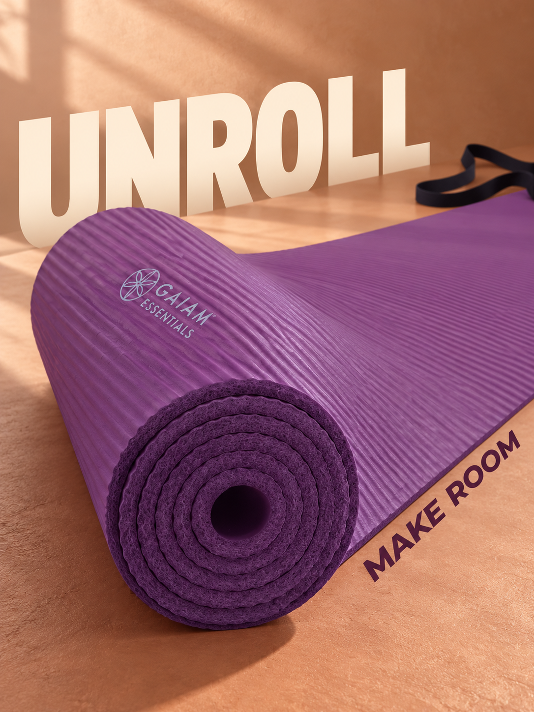
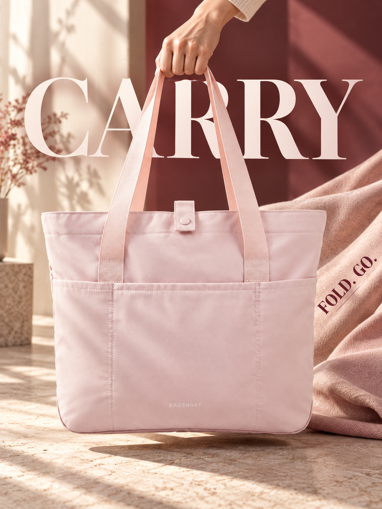
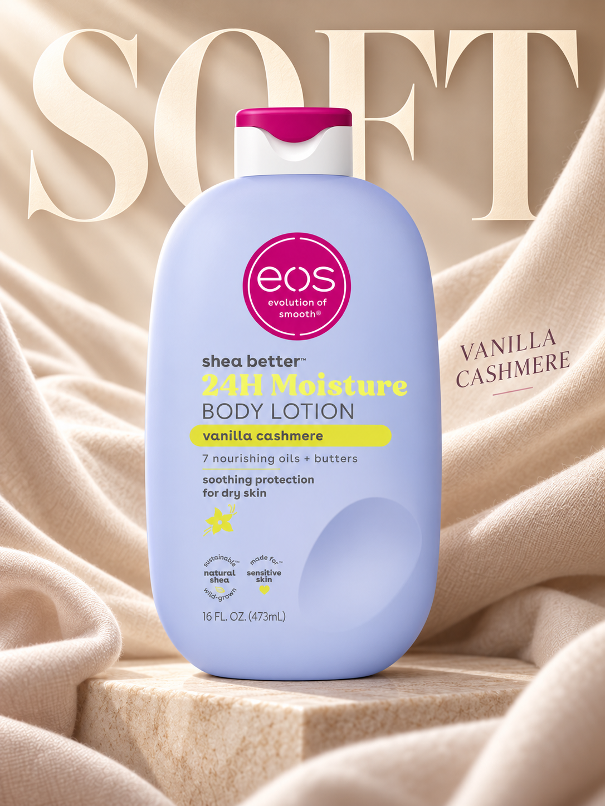

# ZE

### 让商品成为主角，让卖点在画面里发生。

**为 Codex 准备的商品视觉导演 Skill：空间文字、材质张力、动作场景，以及能持续复用的视觉配方库。**

**[English](README.md) · 简体中文**

  

<em>内置生图生成的历史风格样张。空间文字与构图已获审美认可，精确 SKU 结构及数字文案仍需逐商品核验。</em>

ZE 把商品图的视觉决策写进一套可复用的制作流程：先明确商品与本张图的职责，锁定有依据的形状和卖点，再组织镜头、材质、动作与文字，最后查看实际成图并修订。

它适合跨境卖家、电商设计师、独立品牌和制作商品内容的开发者。你得到的是**原技能全部 211 个文件**：实图、配方、失败修复记录、制作规范和辅助脚本一起安装，下次换商品时还能继续查阅和复用。

## 先看它在表达什么

| 材质与纵深 | 接触与动作 | 触感与品牌氛围 |
| :---: | :---: | :---: |
|  |  |  |

以上是库内的 AI 生成设计样张，认可范围保存在各自配方卡中。样张中的品牌、包装文案、参数和图片权利不会随构图一起迁移到新商品。

## 六个值得试用的能力

| 能力 | 具体解决什么问题 |
| --- | --- |
| **文字进入空间** | 标题、局部说明与商品形成前后层次，文字方向跟随商品轴线和作用位置；遮挡设计与逐词可读性分别检查。 |
| **材质拥有张力** | 柔性材料用合理弯折、受压或垂坠，硬质材料用真实接触、曲率和透视对照；控制纹理尺度，保持商品可识别。 |
| **动作带出卖点** | 写清谁施加动作、接触点在哪里、出现什么可见结果，核对手、支撑、重力和使用关系。 |
| **整套图片有分工** | 默认规划 7 张 Listing：主图 1、功能卖点 2、材质 1、使用场景 2、尺寸 1。按当前要求及平台规范调整，每张图承担不同任务。 |
| **经验可以复用** | 按形态、动作、图片用途、设计语言和制作路线检索配方，借用适合的设计关系，重新填写当前 SKU 的事实、Logo 与文案。 |
| **审核保留依据** | 检查外形、件数、接口、附件、颜色、Logo、文字与声明；保留 pass / revise / unknown，美观评分不能覆盖事实错误。 |

## 复制一段话即可开始安装

把下面这段发给 Codex：

~~~text
请安装 https://github.com/thitrang20160-cell/ZE/tree/main/skills/safesell-product-visuals。
先读仓库 README.md，将整个技能目录安装到当前用户的全局技能目录，供多个项目使用。
包含全部 assets、references 和 scripts；备份同名旧版，保留其他技能与配置，避免重复生效。
保持按任务自动识别调用。安装后核对 distribution-manifest.json 的文件哈希，
运行 scripts/recipe_library.py validate，并单独说明可选检测需要的模型、依赖或账号密钥。
失败须调查、修复并复测，不把未完成报告为成功。
~~~

仓库公开，无需 GitHub 登录即可下载。也可以[下载完整 ZIP](https://github.com/thitrang20160-cell/ZE/archive/refs/heads/main.zip)，安装其中的 skills/safesell-product-visuals 整个目录。详见[安装与依赖说明](docs/INSTALL.md)。

## 第一次这样用

上传商品原图后，直接告诉 Codex：

~~~text
用 ZE 为这个商品制作一张广告图。
保持原图中的形状、颜色、Logo 和配件，先突出商品。
让标题参与前中后景关系，并跟随商品或动作的方向。
选择一个符合当前商品的材料事件或使用动作作为视觉重点。
查看实际输出，核对商品身份、文字、接触关系和参考风格。
~~~

也可以按任务提出更明确的要求：

~~~text
做一套 7 张 Listing 图，每张各有职责，先按商品依据规划主图、卖点、材质、场景和尺寸。
~~~

~~~text
这张材质图需要更强张力。选择真实的弯折、垂坠或接触关系，
保留原图纹理尺度，不靠编造内部结构或性能数字制造冲击力。
~~~

安装后的实际技能名为 **safesell-product-visuals**，可显式使用 **$safesell-product-visuals**。元数据允许按任务自动选择；是否加载由目标 Codex 判断，不要求每次都写出技能名。

## 整套里有什么

- **11 张原始风格参考图**，以及用户认可的空间文字锚点。
- **15 张版本化配方卡**，保留适用范围、实图、审核依据和失败修复。
- **12 个视觉家族记录**：家居、厨房、清洁、数码、宠物、园艺、运动、工具、个护、服饰、食品、玩具。
- 主图、功能卖点、材质、使用场景、尺寸、广告等用途的制作指导。
- 配方检索、证据完整性、PNG 来源声明处理、受支持信号检测和交付状态验证脚本。

配方检索后只读最相关的 1–2 张卡及所需锚点，避免每次重新翻完整库。它复用已有经验，不训练模型权重；不承诺固定节省比例。

在安装后的技能目录运行：

~~~powershell
python -X utf8 scripts/recipe_library.py validate
python -X utf8 scripts/recipe_library.py find --morphology flexible-linear --purpose material --route ai-reference-guided --action bend --style technical-studio
~~~

验证器检查配方、素材和证据哈希，不独立判断图片质量，也不能证明历史审核判断必然正确。

## 制作与使用范围

ZE 使用目标 Codex 实际提供的内置生图能力。参考引导生成得到需要核对身份的候选图；需要像素级保留商品时，选择固定真实商品层或有可信渲染层的合成流程。内部结构、未见角度与尺寸依赖额外资料。平台主图规则按当前平台和类目核实。

核心配方脚本使用 Python 标准库。可选检测需要单独准备模型、运行依赖或云端凭证，缺失保留 unknown；来源声明处理与像素水印检测分别记录。详见[依赖说明](docs/INSTALL.md)。

配方成功范围按实际记录保留，不承诺任意商品一次通过、转化率提升，或通用水印去除能力。

## 一起把配方库做得更好

欢迎提交有复用价值的商品配方、失败修复案例及规范改进。带上商品依据、生成结果、明确的审核范围和可复现证据，详见[贡献指南](CONTRIBUTING.md)。

如果 ZE 对你有帮助，欢迎点一颗 **Star**，让更多创作者找到它。也欢迎通过 Issue 分享实际问题与作品，帮助下一批配方更实用。

## 开源许可

原创技能说明、配方结构和原创代码采用 [MIT](LICENSE)。第三方代码保留原许可证，参考图片、品牌和商标保留各自权利，范围见 [NOTICE.md](NOTICE.md)。
